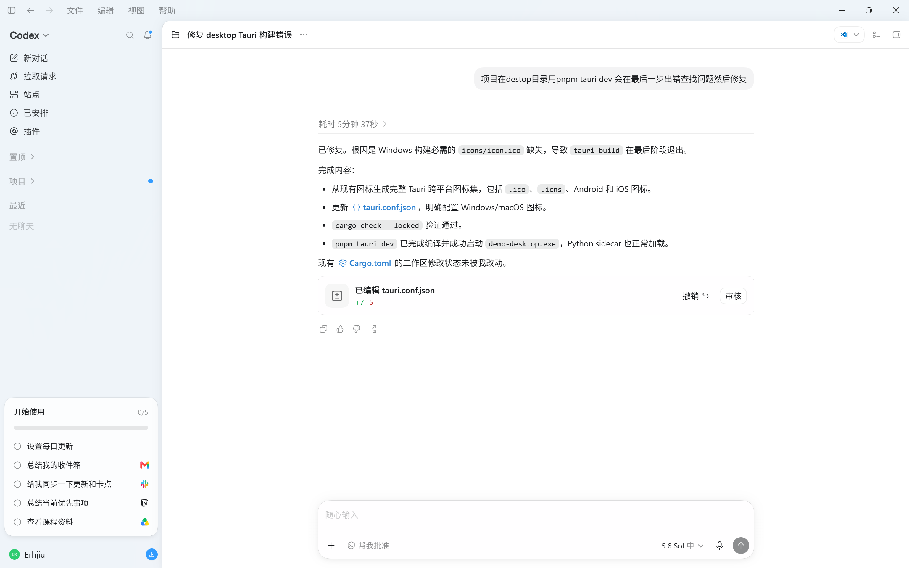

# 项目目标实现

项目意在制作一个形如codeX那样可以全平台发放的ai agent桌面应用

# 项目初步预设技术栈

- langchaim
- kvchache
- langgraph
- mcp

# 项目构想

agent在拿到项目之后会将任务委派给子agent，由agent自身决定agent调用质量（例如codeX中的推理强度）。同时在kvchache层对外开放一些接口，用于用户自生决定去特化agent哪些能力。委派任务应该是个树形图。

# 项目管理

python环境请务必用uv进行管理。

后端代码检查：`bash scripts/lint.sh`（ruff check + ruff format --check + 每个 python 文件不超过 350 行）。

更改后记得修改readme和gitignore

# 前端设计
尽最大可能使用navie-ui，色调只允许出现白黑灰和一点点彩色，不要出现颜色渐变，参考codeX应用界面。

前端实现一定要按照一定工程规范，按功能区分组件和页面，统一采用驼峰命名方式。

# 后端设计

后端设计时按模块进行分包，现阶段在后端生成函数同时占位，工程实现上要符合规范，然后命名用下划线命名，尽可能分装到类进行实践。

后端不要写注释（含 docstring）。

配置规则：非敏感配置（Provider、Base URL、模型）以 SQLite 应用设置为唯一事实源，`.env` 仅作为浏览器开发时的初始默认值；API Key 走系统钥匙串。

# 现阶段任务

## 前端

## 后端

