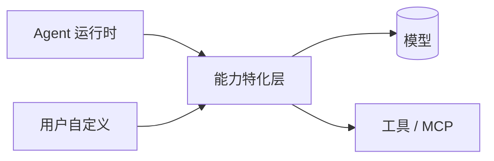
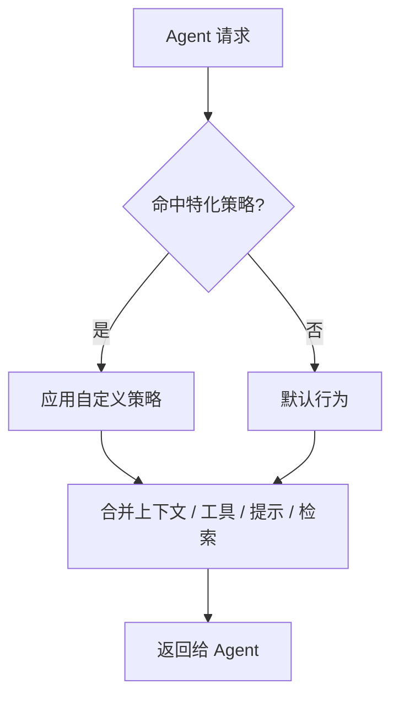

# 能力特化层

> 本章为**参考设计**。能力特化层（Capability / Specialization 层）是用户**特化 Agent 能力**的对外接口，与缓存**解耦**。

## 定位

能力特化层位于 Agent 运行时与模型/工具之间，负责把用户自定义的上下文、工具、提示与检索策略**注入**到委派树中的各个 Agent：

> 命名说明：早期构想中的 “KV Cache 特化层” 把「能力特化」与「缓存」混在一起。现已**解耦**——能力特化层专注“让 Agent 更像你的团队”，缓存（prompt / 结果缓存）是独立的性能优化手段，二者分开设计。见 [ADR-001](decisions.md#adr-001)。

## 可插拔的四类能力

| 方向 | 说明 | 示例 |
| --- | --- | --- |
| 上下文特化 | 注入项目/团队背景 | 团队编码规范、领域知识、私有文档索引 |
| 工具特化 | 注册仅本项目可用的工具 | 内部 API、构建脚本、issue 工具、MCP Server |
| 提示特化 | 覆盖或扩展提示 | 系统提示、输出风格、评审清单 |
| 检索特化 | 自定义检索与召回 | 特定文件索引、语义检索、权限过滤 |

## 接口设计方向

能力以**可插拔、可组合**的策略注册，而非硬编码分支：

设计原则：

1. **不侵入编排**：特化只影响注入给 Agent 的内容，不改动委派图结构；
2. **可组合**：多个策略按优先级叠加合并；
3. **可回退**：策略缺失或出错时回退到默认行为，不阻塞主流程；
4. **按作用域生效**：支持全局 / 项目 / 子树 / 单任务等不同作用域。

## 与缓存的关系

| 层 | 职责 | 是否对外 |
| --- | --- | --- |
| 能力特化层 | 决定 Agent「**能做什么、知道什么**」 | 是（核心接口） |
| 缓存层 | prompt / 结果复用，降低 token 成本与延迟 | 否（内部优化） |

缓存层的键设计、失效策略（项目文件变更后如何失效）在实现阶段单独设计，不与特化接口混用。

## 边界情况

- 策略冲突与优先级；
- 特化内容的权限与安全边界（注入的上下文是否可被提示注入利用）；
- 作用域继承与覆盖规则。

相关：[总体架构](overview.md) · [MCP 集成](mcp.md) · [ADR-001](decisions.md#adr-001)。
