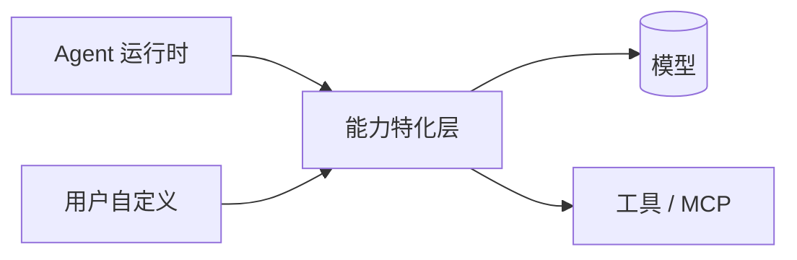
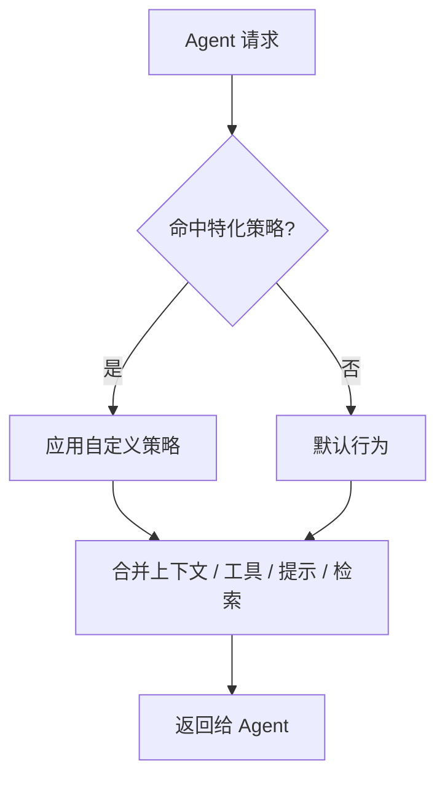

# 能力特化层

> 本章记录能力特化层（Capability / Specialization）的参考设计。2026-11-06 补充 AuroraHarness 第一版接口方案及“本轮能力清单”设计。接口示例面向 AuroraHarness 单仓，文档站仓库中的 demo_agent 不提供这些接口；开发中的实现不表示已合并发布。

## 定位

能力特化层位于 Agent 运行时与模型/工具之间，负责把用户自定义的上下文、工具、提示与检索策略**注入**到委派树中的各个 Agent：



> 命名说明：早期构想中的 “KV Cache 特化层” 把「能力特化」与「缓存」混在一起。现已**解耦**——能力特化层专注“让 Agent 更像你的团队”，缓存（prompt / 结果缓存）是独立的性能优化手段，二者分开设计。见 [ADR-001](decisions.md#adr-001)。

## 可插拔的四类能力

| 方向 | 说明 | 示例 |
| --- | --- | --- |
| 上下文特化 | 注入项目/团队背景 | 团队编码规范、领域知识、私有文档索引 |
| 工具特化 | 注册仅本项目可用的工具 | 内部 API、构建脚本、issue 工具、MCP Server |
| 提示特化 | 覆盖或扩展提示 | 系统提示、输出风格、评审清单 |
| 检索特化 | 自定义检索与召回 | 特定文件索引、语义检索、权限过滤 |

## 接口设计方向

能力以**可插拔、可组合**的策略注册，而非硬编码分支：



设计原则：

1. **不侵入编排**：特化只影响注入给 Agent 的内容，不改动委派图结构；
2. **可组合**：多个策略按优先级叠加合并；
3. **可回退**：策略缺失或出错时回退到默认行为，不阻塞主流程；
4. **按作用域生效**：支持全局 / 项目 / 子树 / 单任务等不同作用域。

## 与缓存的关系

| 层 | 职责 | 是否对外 |
| --- | --- | --- |
| 能力特化层 | 决定 Agent「**能做什么、知道什么**」 | 是（核心接口） |
| 缓存层 | prompt / 结果复用，降低 token 成本与延迟 | 否（内部优化） |

缓存层的键设计、失效策略（项目文件变更后如何失效）在实现阶段单独设计，不与特化接口混用。

## 第一版接口与可解释执行

能力特化的新增设计是“本轮能力清单”：为每次角色执行保存生效策略、回退项和实际输入，让用户能复核 Agent 当时依据的规范。界面视图及能力配方导入仍属于后续规划。

## 注册策略

```python
from pathlib import Path

from aurora.agent.capability import (
    Capability,
    CapabilityPolicy,
    CapabilityRegistry,
    CapabilityScope,
)
from aurora.agent.orchestration.runtime import AgentRuntime

capabilities = CapabilityRegistry()
capabilities.register(
    CapabilityPolicy(
        name="team-conventions",
        apply=lambda context: Capability(
            context="该项目使用 uv 管理 Python 环境。",
            instructions="回答使用中文，报告实际执行过的验证。",
        ),
        scope=CapabilityScope("project", Path("/path/to/project")),
        priority=10,
    )
)
runtime = AgentRuntime(capabilities=capabilities)
```

`Capability` 提供四类注入：

| 字段 | 含义 |
| --- | --- |
| `context` | 作为当前输入中的参考材料传递，不提升为系统指令 |
| `instructions` | 追加到角色指令，保留角色原有要求 |
| `tools` | `Tool` 元组；与角色工具白名单取交集后交给原确认门 |
| `retrieve` | 可选的同步检索回调，接收 `CapabilityContext` 并返回参考文本 |

策略回调属于应用宿主注册的可信 Python 扩展。注册本身不授权工具执行；自定义工具应使用会话沙箱实现文件或命令操作。检索回调只应读取所需信息，不执行需审批的操作。普通用户创建角色和提示词仍使用既有界面。

## 作用域与组合规则

| 作用域 | 匹配规则 |
| --- | --- |
| `global` | 所有项目与角色 |
| `project` | 规范化后的项目目录完全相同 |
| `subtree` | 项目相同，任务路径以给定路径段开头 |
| `task` | 项目相同，任务路径完全相同 |

`CapabilityContext` 包含 `project_path`、`goal`、`agent_id` 和 `task_path`。项目路径通过 `Path.resolve()` 规范化；不按字符串前缀匹配项目。任务路径是任务 ID 元组，不是用斜杠拼接的字符串。

当前主角色的任务路径为 `()`，动态委派角色为 `(父规划任务ID,)`。这里的单任务指一次交给 Agent 的任务，工具叶子不会单独建立模型上下文。解析器支持更深路径，当前运行时仍遵循子角色不递归委派的限制。回调可用 `agent_id` 进一步选择特定角色。

策略按 `(priority, 作用域层级, 路径深度, name)` 升序应用。优先级相同时，全局先于项目，项目先于子树和单任务；同层按名称排序，与注册先后无关。文本按顺序追加；多个策略提供同名自定义工具时，后者生效。内置工具、MCP 工具及 `list_agents`、`call_agent`、`agent_respond` 不允许被策略覆盖。

每项策略先完成回调、检索、内容及工具校验，再整体合并。任一步异常、重名冲突或内容超限时跳过整项，保留默认能力和其他成功策略。日志只记录失败策略名，不记录异常原文或检索内容。

解析器的附加文本预算默认 16,000 个 UTF-8 字节；运行时还会以当前模型剩余预算收紧它。过大的策略回退，不挤掉当前用户输入。历史仍按完整公共轮次裁剪。

## 本轮能力清单

新设计让每个角色的能力组合可以解释和复核：

1. 运行开始时冻结注册清单，之后注册或移除策略只影响下一轮。
2. 角色开始时解析匹配策略，把实际参考材料写入 `AgentRun.input.current`，把最终指令写入角色配置快照。
3. `AgentRun.input.capabilities.applied` 按应用顺序保存成功策略名，`failed` 保存回退策略名，可通过 `run.get` 或 `agentRun.get` 读取。
4. 审批恢复复用该角色已构建的图、工具和输入，不重新调用策略或检索器，不重放已完成任务。

冻结的是注册项，不会复制回调依赖的外部文件、网络索引或可变闭包。后续阶段首次解析时仍可能看到更新后的外部资料；历史记录保存的是当次实际输入。需要严格固定版本的策略，应在注册时绑定不可变资料或版本化索引。

上下文特化已接入编写、直接对话、仅规划、动态委派、视觉审查和汇总阶段。审查与汇总始终不执行注入工具。清单目前通过运行详情接口读取，专门的界面视图、声明式配方导入及云端同步留待后续实现。

## 验证与实现边界

在 AuroraHarness 仓库根使用 `node scripts/tasks.mjs lint` 和 `node scripts/tasks.mjs test-python`。验证覆盖作用域隔离、确定性顺序、原子回退、工具权限、审批恢复、委派继承、内容预算与持久化清单。注册接口位于 `src/agent/src/aurora/agent/capability/`，没有新增协议版本或数据库迁移。

模块命名规则见[贡献指南](../contributing.md#python-模块命名)。

相关：[总体架构](overview.md) · [MCP 集成](mcp.md) · [ADR-001](decisions.md#adr-001)。
