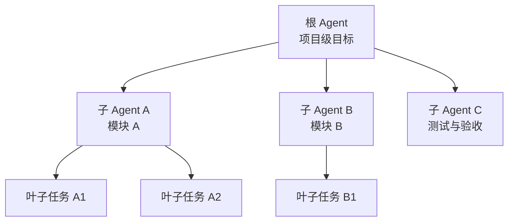
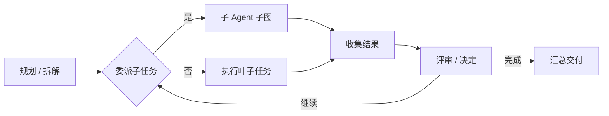

# 任务委派树

## 当前开发实现

AuroraHarness 已接通 SDK 可配置的 0–16 层委派、整轮共享任务预算、深层审批与取消，以及整轮/子树/叶子重试。子角色使用独立模型和权限，历史通过持久父任务 ID 关联。具体限制与验证见[执行校验与资源限制](execution-runtime.md)。

等待人工输入时，父图和嵌套子图可以保存检查点。重启后，符合恢复条件的运行会回到原任务的待办。并行子树与依赖调度仍待实现。

> 本章为**参考设计**。任务委派是项目最核心的编排形态，目标是一张**树形图**。

## 为什么是树

把一个大型项目目标塞进单一 Agent 的上下文里不可扩展。树形委派把任务**递归拆解**：

- **根 Agent** 只做顶层规划与拆解，不陷入细节；
- **子 Agent** 各自聚焦一个子树，上下文隔离；
- **叶子任务** 是可直接执行的最小单元。

## 用 LangGraph 承载

LangGraph 天然适合表达“图 + 状态 + 检查点”，委派树可以映射为：

- **状态图（StateGraph）**：树的每个节点是一个可执行步骤，边表示委派/依赖关系；
- **子图（Subgraph）**：子 Agent 的完整工作流作为一个子图挂载到父节点；
- **检查点（Checkpoint）**：每个节点的状态可持久化，支持恢复与重试。

## 树形结构带来的能力

- **上下文隔离**：每个子 Agent 只携带自己子树所需上下文；
- **并行与依赖**：兄弟子树可并行，父子子树存在依赖；
- **局部重试**：某个叶子失败，只重试该子树，不整体回退；
- **可观测**：进度、成本、结果可沿树逐节点追踪。

## 边界情况（待实现阶段细化）

- 子树之间的共享上下文如何安全传递；
- 树深与扇出上限，避免无限递归委派；
- 失败传播策略：子任务失败在哪些层级上让父任务重规划。

相关：[推理强度](reasoning-effort.md) 决定每个委派节点投入多少推理。
