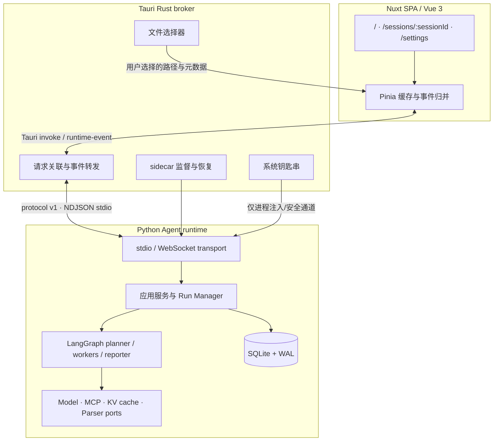
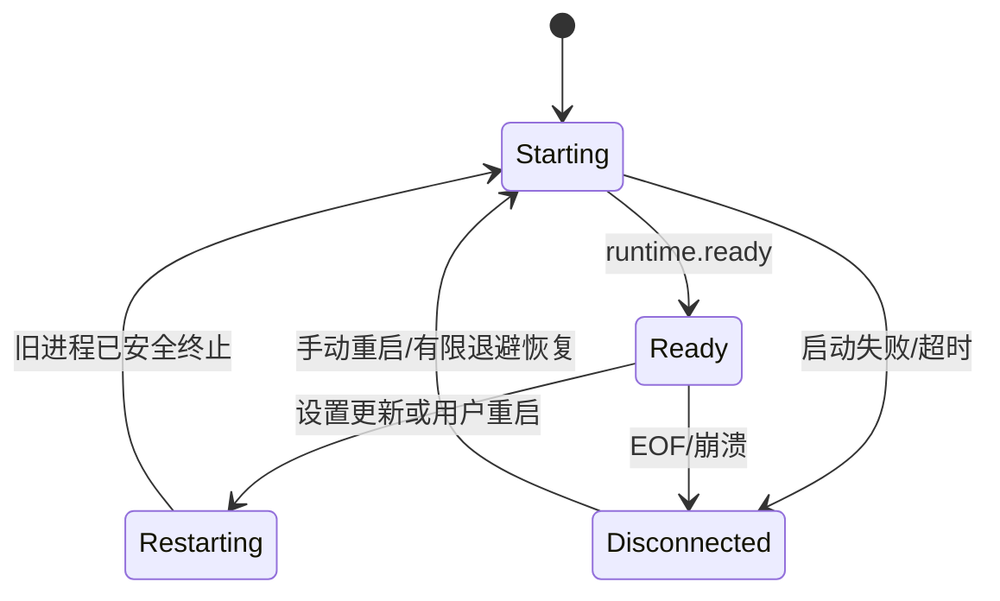

# 桌面应用架构

桌面应用采用 **Tauri 2 + Nuxt（Vue 3 + TypeScript）+ Python sidecar**。Nuxt 负责交互，Rust 是可靠 broker 与系统能力边界，Python 承载 Agent 业务和 SQLite 数据。公共消息定义见[运行时协议 v1](runtime-protocol.md)。

## 目标与边界

桌面壳负责：

1. 承载 Codex 风格工作台、连续对话、委派树、确认门和设置页；
2. 监督 Python sidecar 的启动、停止、重启、崩溃恢复和健康状态；
3. 关联请求/响应并转发全局事件；
4. 通过系统钥匙串管理 API Key，通过系统文件选择器授予明确的文件引用。

Rust 不实现会话、运行和任务业务；Pinia 不作为持久化数据库；Python 不管理系统钥匙串或任意弹出文件选择器。

## 分层视图



## 数据所有权

| 数据 | 唯一事实源 | 允许缓存 | 禁止位置 |
| --- | --- | --- | --- |
| 会话、消息、运行、任务、附件、确认 | Python SQLite | Pinia 内存快照 | localStorage |
| Provider、Base URL、模型 | Python SQLite | 设置页短期状态 | 日志中的敏感上下文 |
| API Key | 系统钥匙串 | 设置输入框提交前的瞬时值 | Python SQLite、Pinia、localStorage、事件、日志 |
| 主题、侧栏状态、迁移标记 | localStorage | Pinia UI Store | Agent 事件 |
| runtime 连接状态 | Rust broker 真实状态 | Pinia | 前端乐观常量 |

SQLite 启用 foreign keys、WAL、busy timeout 和版本化迁移。事件只通知变化；页面恢复必须重新读取 SQLite 快照。

## Python runtime 分层

建议按领域、应用、端口、适配器和传输拆包：

```text
demo_agent/
  domain/          # 会话、运行、任务、消息等实体和值对象
  application/     # session service、run manager、approval service
  ports/           # ModelPort、McpPort、KvCachePort、DocumentParserPort
  adapters/        # SQLite、确定性 mock、未来生产适配器
  transport/       # envelope 校验、dispatcher、stdio、WebSocket
```

- 领域层不依赖 Tauri、WebSocket 或具体模型 SDK。
- 应用层通过端口协调 LangGraph、事务、确认和取消。
- SQLite adapter 是数据事实源，迁移与 CRUD 不得占位。
- 无密钥时启用确定性 Mock planner/worker，完整产出递归任务、流式消息和报告。
- 尚未实现的生产 Model/MCP/KV/文档解析 adapter 必须抛 `NotImplementedError`；抽象端口方法允许 `pass`。

### Run Manager

Run Manager 按 `session_id` 维护活动运行锁和取消令牌：

- 同一会话最多一个活动运行；重复启动返回 `RUN_ALREADY_ACTIVE`。
- 不同会话可以并行，事件均携带 `session_id` 和 `run_id`。
- 取消是协作式的，worker 在安全点检查令牌；完成取消持久化后释放锁。
- 重试创建新的 `run_id` 并记录来源，可重试整次失败运行或指定任务。
- sidecar 崩溃恢复后清理遗留活动状态，避免永久锁死会话。

### 确认门

危险工具执行先持久化 approval，再发 `approval.requested`。批准、拒绝或超时都持久化明确结果，并发 `approval.resolved`。确认路径不得使用 `pass`，不得把“未收到回复”当作批准。

## Rust broker

Rust broker 维护 sidecar 进程句柄、stdin writer、stdout reader、pending request map 和 runtime 状态机。



### 请求与事件

1. 前端提交 protocol v1 request envelope。
2. Rust 在 pending map 登记 `request_id`，再写入 sidecar stdin。
3. Python stdout 的 response 只完成相同 `request_id` 的 invoke；event 作为全局 `runtime-event` 广播。
4. 超时、EOF、重启或崩溃必须用 `RUNTIME_UNAVAILABLE` 完成所有 pending request。
5. Rust 缓存 runtime 状态供 `runtime.status` 使用，但 `ready` 只能来自已完成握手的 sidecar。

stdio 使用 UTF-8 NDJSON，每行仅一个协议对象。Python stdout 禁止业务日志；stderr 可以记录脱敏诊断。独立开发和一致性测试可启用 WebSocket transport，它必须复用相同 dispatcher、模型和事件语义。

### sidecar 生命周期

- 应用启动时读取非敏感配置和钥匙串状态，启动 sidecar 并等待 `runtime.ready`。
- 崩溃后记录退出码，广播 `runtime.disconnected`，按有限指数退避恢复；连续失败后等待用户重启。
- 安全重启先停止接收新请求，结束/取消活动调用，终止旧进程，再创建全新的读写任务。
- 应用退出时关闭 stdin 并等待子进程，超时后再强制终止，避免孤儿进程。

## 钥匙串与模型设置

前端 `settings.update` 的 `api_key` 由 Rust 截获并直接写系统钥匙串，不转发到普通日志或 SQLite。Python 只接收运行所需的安全注入，并通过 `settings.get` 暴露 `api_key_configured: boolean`。

- Provider、Base URL、模型名属于非敏感配置，写入 SQLite。
- 设置成功后清除前端输入框；任何响应都不回显 Key。
- 配置需要重启时由 Rust 执行安全重启，UI 跟随真实状态变化。
- 钥匙串不可用时返回 `KEYRING_UNAVAILABLE`，不得无提示回退明文文件。

## 文件选择与附件

Tauri 文件选择器是本地路径授权入口。前端只能把用户主动选择的路径、文件名、大小和 media type 作为附件引用传给 Python。

- 首版不自动读取、上传或解析附件。
- 不允许目录通配、父目录扩权或根据文件名猜测其他路径。
- 文件在运行前失效时返回可理解错误并保留元数据。
- `DocumentParserPort` 作为扩展点；未实现生产解析器时明确报 `NotImplementedError`，不能静默声称解析成功。

## 关键数据流

### 启动与恢复

Rust spawn sidecar → Python 执行数据库迁移并打开 WAL → transport 发 `runtime.ready` → Rust 状态转 Ready 并转发 → 前端请求 `session.list`。若前端持有旧 localStorage 数据，再执行一次幂等 legacy import。

### 连续对话

前端 `session.create` → Python 事务创建会话 → 前端 `run.start` → Python 写用户消息和运行 → LangGraph 规划/并行 worker/报告 → 事务提交后发消息、任务和运行事件。下一轮继续使用原 `session_id`，创建新 `run_id`。

### 多会话并行

会话 A 与 B 各自持有运行锁并可并行；Rust 不根据当前页面筛选事件，前端 Store 使用 `session_id/run_id/task_id` 归并。切换页面不会停止后台任务。

### 旧数据迁移

前端检测 `demo-agent:sessions:v1` → 以稳定 `import_id` 调用 `session.import_legacy` → Python 在单个 SQLite 事务中写入合法记录与导入标记 → 返回计数。仅 `ok: true` 且无失败记录后，前端写迁移标记并删除旧 payload；否则原数据保留重试。

## 安全要求

- Tauri capability 最小化，webview 无任意 filesystem/shell 权限。
- API Key 不进入 SQLite、Pinia、localStorage、请求/事件日志和 Agent 上下文。
- `base_url` 等外部端点必须校验；错误响应与 stderr 脱敏。
- Markdown/工具输出是不可信输入，前端渲染前清理 HTML。
- 确认门默认拒绝并具有超时；危险操作不得绕过 transport/application 校验。
- SQLite migration、transport、确认、取消、请求关联和 keyring 路径必须有测试，不能静默占位。

## 测试与验收

| 层 | 必测内容 |
| --- | --- |
| Python | SQLite CRUD/迁移、连续消息、并行/互斥、取消、重试、确认超时、Mock 树、stdio/WS 一致性 |
| Rust | NDJSON 分帧、request 关联、事件转发、重启/崩溃恢复、keyring 抽象、无密钥日志 |
| 前端 | 多运行隔离、会话管理、legacy import、附件、停止/重试、递归树、设置表单 |
| 构建 | `uv run pytest`、`pnpm typecheck`、`pnpm test`、`pnpm generate`、`cargo test --locked`、`cargo check --locked` |
| 桌面 | `pnpm tauri dev` 完成连续对话、两会话并行、停止、重试、确认、附件、重启恢复和设置更新 |

视觉验收覆盖 1200×800、小窗口及 Windows 100%/125%/150% 缩放；侧栏与委派树撑满视口，输入框固定底部且无横向溢出。

## 跨平台分发

Python 环境和依赖统一由 uv 管理。发布时使用自包含 Python runtime 随 Tauri sidecar 分发，不依赖系统 Python。CI 覆盖 Windows、macOS、Linux，并对二进制和更新清单签名。

## 深入阅读

- [运行时协议 v1](runtime-protocol.md)
- [前端路由与接入](frontend-routes.md)
- [总体架构](overview.md)
- [任务委派树](delegation-tree.md)
- [模型接入](model-access.md)
- [关键决策](decisions.md)
