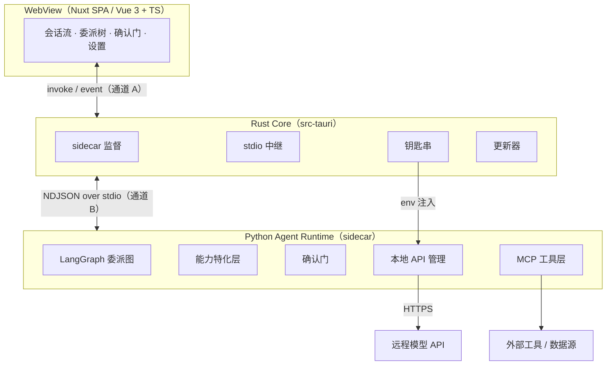

# 桌面应用架构

> 本章为**落地规划**，对应 [ADR-007](decisions.md#adr-007)：桌面壳由 Electron（+React）切换为 **Tauri 2 + Nuxt（Vue 3 + TS）**，Python Agent 运行时以 sidecar 进程打包分发，进程间走 **stdio**。实现落地后如有调整将回写本页。

## 定位

桌面应用是项目的最终交付形态：把「本地 Python 运行时 + 远程模型」装进一个跨 macOS / Windows / Linux 的桌面壳，交付给终端用户。壳本身不承载 Agent 业务逻辑，只负责三件事：

1. **承载前端 UI**（会话流、委派树可视化、确认门弹窗、设置页）；
2. **监督 Python 运行时**（拉起、注入配置、崩溃检测、重启）；
3. **中继与管理**（stdio 中继、钥匙串、更新、单实例、文件对话框）。

## 技术选型

| 组件 | 角色 | 说明 |
| --- | --- | --- |
| [Tauri 2](https://tauri.app/) | 桌面壳 / 打包 | Rust 核心 + 系统 webview，体积小、内存低、能力权限最小化 |
| [Nuxt](https://nuxt.com/) | 前端框架（SPA） | Vue 3 + TypeScript，`ssr: false`，取文件路由 / 自动导入 / 模块生态 |
| Rust（`src-tauri`） | 系统胶水 + stdio 中继 | sidecar 监督、钥匙串、更新器、单实例、NDJSON 转发 |
| Python sidecar | Agent 运行时 | 复用 `demo_agent/`，以 python-build-standalone + uv 打包 |

> 「Nuxt 做逻辑 + Vue 做前端」= Nuxt（基于 Vue 3 + TS）承载前端应用与业务逻辑。桌面无 SSR 需求，故用 SPA 模式；若后续觉得 Nuxt 过重，可回退到「Vite + Vue 3 + TS」，共享同一组件层。

## 分层视图



分层职责沿用[总体架构](overview.md)：仅替换「桌面壳」与「壳 ↔ 运行时」通信两处，运行时与基础设施层保持不变。

## 进程模型与通信

两条通道，职责分离：

| 通道 | 链路 | 用途 |
| --- | --- | --- |
| A · Tauri IPC | 前端 ↔ Rust | 系统能力：钥匙串读写、sidecar 生命周期、文件对话框、更新 |
| B · stdio 中继 | 前端 → Rust → Python | Agent 事件流：委派树、token、结果、确认门 |

**通道 B 采用 stdio（NDJSON 中继）**，运行时**不监听任何本地端口**：

1. Rust spawn sidecar，建立其 stdin/stdout 管道；
2. Python 在 stdout 上按行输出 JSON 事件（NDJSON），从 stdin 按行读取命令；
3. Rust 把 stdout 事件转为 Tauri event 推给前端，把前端 `invoke` 命令写入 stdin；
4. 密钥等配置由 Rust 经环境变量在 spawn 时注入，不进 webview。

### 消息契约

沿用 `demo_agent/server.py` 的 JSON 事件协议，但传输改为 **stdin/stdout 上的 NDJSON（每行一个 JSON 对象）**：

```text
Python → Rust（stdout）: hello / run_start / plan{tasks[]} / task_start{task_id,description,effort}
                         token{task_id,text} / task_result{task_id,result} / report{report}
                         done / error{message} / confirm_request{request_id,action,risk}
Rust → Python（stdin）:  {"type":"run","objective":string}
                         {"type":"confirm","request_id":string,"approved":bool}
```

约束：每条消息 `json.dumps` 紧凑序列化（内嵌字符串的换行被转义，不破坏行分帧），以 `\n` 分隔；Python 侧用 asyncio 读写 stdio 流，Rust 侧持续读取子进程 stdout 并转发。独立开发联调仍可用 `--port` 起 WS 服务。

## 关键数据流

1. **启动**：Rust 启动 → 读钥匙串 → spawn sidecar（注入 `AGENT_*`）→ 建立 stdio 管道 → Python 回 `hello` → Rust 转事件推前端 → UI 就绪。
2. **一次任务**：前端 `invoke agent_run` → Rust 写 `run` 到 stdin → Python 回 `plan`/`task_start`/`token`/`task_result`/`report`/`done` → Rust 转发 → 前端渲染。
3. **确认门**：write/execute 工具 → `gate.request` → `confirm_request` → Rust 转发 → 前端弹窗 → `invoke agent_confirm` → Rust 写 `confirm` → `gate.respond` 继续/拒绝（读放行、默认拒绝，见 [ADR-005](decisions.md#adr-005)）。
4. **密钥配置**：设置页填 key → `set_api_key` → Rust 写钥匙串 → 重启 sidecar 生效；key 不经 webview、不打印（见 [ADR-002](decisions.md#adr-002)）。

## 安全模型

- **Tauri 能力最小化**：前端默认无任意 fs/shell 权限，仅白名单命令；webview 无 Node 运行时；CSP 收紧。
- **密钥与 webview 隔离**：钥匙串由 Rust 管理，仅以环境变量注入 sidecar，前端只读脱敏摘要。
- **无网络监听面**：运行时仅经父子进程 stdio 管道通信，不开放本地端口，进一步收窄攻击面。
- **确认门保留**：read 放行、write/execute 默认拒绝（[ADR-005](decisions.md#adr-005)）。
- 与 ADR-005 待办（白名单/dry-run/沙箱、MCP 供应链、防提示注入）协同推进。

## 跨平台打包与分发

- **sidecar**：CI 三平台矩阵用 **python-build-standalone + uv** 组装自包含运行时——独立可重定位的 CPython + `uv pip install` 装好的站点包，作为资源目录随包分发，由薄启动器拉起 `python -m demo_agent.server --stdio`。不依赖系统 Python，且避免 PyInstaller 对 pydantic / langchain 动态导入的冻结风险。
- **Tauri 打包**：macOS 双架构、Windows x64/ARM64、Linux deb/rpm/AppImage；macOS notarization + codesign、Windows 签名、Linux 签名。
- **自动更新**：`tauri-plugin-updater` + 静态 JSON 发布源，开启签名校验。
- **CI**：GitHub Actions OS 矩阵，产物与更新清单自动发布。

## 边界情况与失败模式

- sidecar 崩溃/启动失败 → Rust 检测 stdout EOF + 退出码，UI 显示错误态 + 重启按钮；
- 流式背压 → Python outbox 有界化，超出丢弃告警；Rust 读 stdout 持续转发，避免 UI 卡顿反压运行时；
- 钥匙串不可用（Linux 无 secret service）→ 回退本地加密文件并提示；
- 开发 vs 打包：开发用 `uv run python -m demo_agent.server --stdio`，打包用 bundled 运行时；
- webview 差异（WKWebView / WebView2 / WebKitGTK）→ 三平台冒烟测试，Linux 声明 webkit2gtk 依赖；
- 无密钥 mock 模式保持可离线演示；
- 单实例 → 二次启动聚焦已有窗口。

## 分阶段路线

- **A**：ADR-007 + 本页 + 回写 roadmap/tech-stack/README；
- **B**：脚手架 Tauri 2 + Nuxt(SPA)；`server.py` 增 `--stdio` 传输；Rust 实现 NDJSON 中继；复刻 MVP 交互；
- **C**：sidecar 监督、钥匙串、单实例；
- **D**：python-build-standalone + uv 组装 sidecar、三平台 CI、签名/公证、自动更新；
- **E**：会话持久化、任务树取消/重试、MCP 完整接入、能力特化层 v1、沙箱。

## 深入阅读

- [总体架构](overview.md)
- [模型接入与 API 管理](model-access.md)
- [能力特化层](capability-layer.md)
- [关键决策 (ADR)](decisions.md)
