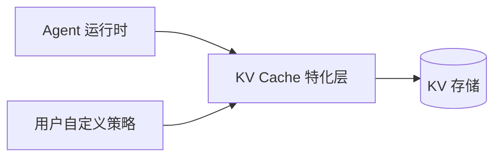
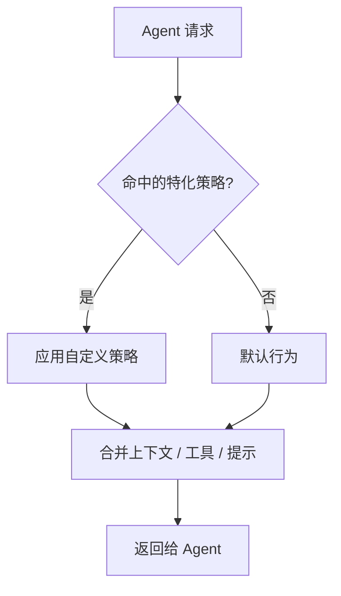

# KV Cache 特化层

> 本章为**参考设计**。KV Cache 层既做缓存，也承担“能力特化”的对外接口职责。

## 定位

KV Cache 层位于 Agent 运行时与持久化存储之间，是用户**特化 Agent 能力**的落点：

## 双重职责

### 1. 缓存

- 缓存项目上下文、子任务结果、工具调用结果等；
- 复用高频内容，降低 token 成本与延迟；
- 为委派树的局部重试提供可复用的中间结果。

### 2. 能力特化（对外接口）

对外暴露接口，让用户**自行决定特化 Agent 的哪些能力**，例如：

| 特化方向 | 示例 |
| --- | --- |
| 上下文特化 | 注入团队规范、私有领域知识、特定文件索引 |
| 工具特化 | 绑定仅本项目可用的内部工具 |
| 提示特化 | 覆盖或扩展系统提示、输出风格 |
| 检索特化 | 自定义检索与召回策略 |

## 接口设计方向

接口应是**可插拔、可组合**的策略，而非硬编码分支：

具体接口形态（注册机制、策略优先级、作用域）在实现阶段细化。设计原则：

1. **不侵入编排**：特化只影响缓存层返回值，不改动委派图结构；
2. **可组合**：多个策略可叠加，按优先级合并；
3. **可回退**：策略缺失或出错时回退到默认行为，不阻塞主流程。

## 边界情况

- 缓存键设计与失效策略（项目文件变更后如何失效）；
- 特化策略之间的冲突与优先级；
- 特化内容的权限与安全边界。

相关：[总体架构](overview.md) · [MCP 集成](mcp.md)。
