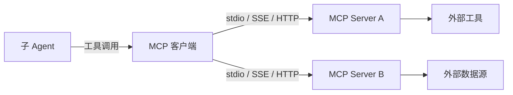

# MCP 集成

> 本章为**参考设计**。MCP（Model Context Protocol）是 Agent 接入外部工具与数据源的统一协议。

## 为什么用 MCP

- **统一协议**：不同工具以统一的 Server 形式接入，Agent 无需感知各自实现；
- **可扩展**：新增能力只需启动一个 MCP Server 并注册，无需改核心代码；
- **生态复用**：可直接使用社区已有的 MCP Server。

## 接入方式

- **MCP 客户端**：内嵌在 Agent 运行时中，负责连接与协议通信；
- **MCP Server**：以 stdio / SSE / HTTP 等方式运行，暴露工具（tools）、资源（resources）与提示（prompts）；
- **传输方式**：桌面场景优先本地 stdio 进程，远程场景可用 SSE / HTTP。

## 与能力特化层的关系

- MCP 提供**外部能力**（工具 / 数据）；
- 能力特化层提供**项目内特化**（上下文 / 工具 / 提示 / 检索），并可把 MCP Server 注册为特化工具；
- 两者互补：Agent 通过 MCP 调用工具，通过能力特化层获得特化后的上下文。

## 边界情况

- Server 生命周期管理（随应用启动 / 按需拉起）；
- 工具权限与用户授权；
- 远程 Server 的网络与鉴权。

相关：[总体架构](overview.md) · [能力特化层](capability-layer.md)。
