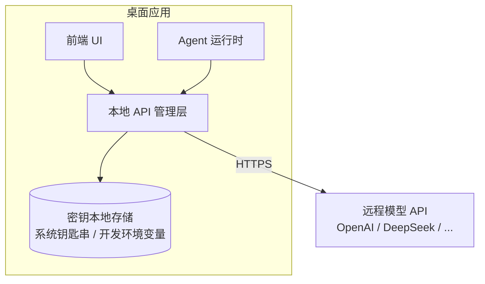

# 模型接入与本地 API 管理

> 本章为**参考设计**。模型走**远程 API 接口**，但 API 凭据与端点由**本地 API 管理层**统一管理，密钥不进入 Agent 上下文、不落日志。

## 决策

模型不本地打包（放弃 Ollama / llama.cpp 的本地推理路线），统一通过**远程 API**访问；在应用内提供一层**本地 API 管理**，负责：

- 密钥的本地保存与读取（发布版使用系统钥匙串；开发运行可由环境变量注入）；
- 端点（base_url）与模型名的统一配置；
- 面向不同 Agent 的客户端构建；
- 密钥脱敏与防泄露。

见 [ADR-002](decisions.md#adr-002)。

## 为什么这样选

| 方案 | 优点 | 缺点 |
| --- | --- | --- |
| 远程 API + 本地管理（选定） | 无需打包模型、跨平台一致、可切换多家供应商 | 依赖网络、密钥需妥善管理 |
| 本地推理（Ollama / llama.cpp） | 离线、数据不出本机 | 打包体积大、硬件适配难、跨平台维护成本高 |

CodeX 本身是云侧方案；本项目的桌面形态保留“本地运行时 + 远程模型”的折中，避免把“全平台”拖入本地推理的适配泥潭。

## 本地 API 管理层

职责与约束：

1. **统一入口**：所有 Agent 通过管理层拿模型客户端，不在代码里散落 key；
2. **密钥不泄露**：key 只用于构造客户端，不写入图状态、不打印、不进日志；
3. **可切换供应商**：非敏感的 provider、`base_url` 与 model 写入 Python SQLite；`api_key` 由 Tauri Rust 直接写系统钥匙串，设置读取只返回是否已配置；
4. **无 key 可运行**：用户可显式选择 **mock 模式**，用确定性输出跑通流程；选择 OpenAI-compatible Provider 后缺少密钥必须明确失败，不能静默回退。

## 环境变量约定（demo）

| 变量 | 说明 | 默认 |
| --- | --- | --- |
| `AGENT_API_KEY` | API 密钥（回退读 `OPENAI_API_KEY`） | OpenAI 模式必填 |
| `AGENT_BASE_URL` | OpenAI 兼容端点 | `https://api.openai.com/v1` |
| `AGENT_MODEL` | 模型名 | `gpt-4o-mini` |

> 环境变量仅用于开发/测试注入，发布版以系统钥匙串为准。API Key 不进入 SQLite、Pinia、localStorage、Agent 事件或日志；设置更新需要时由 Rust 安全重启 sidecar。

相关：[技术栈](../overview/tech-stack.md) · [运行最小 demo](../getting-started/demo.md) · [ADR-002](decisions.md#adr-002)。
