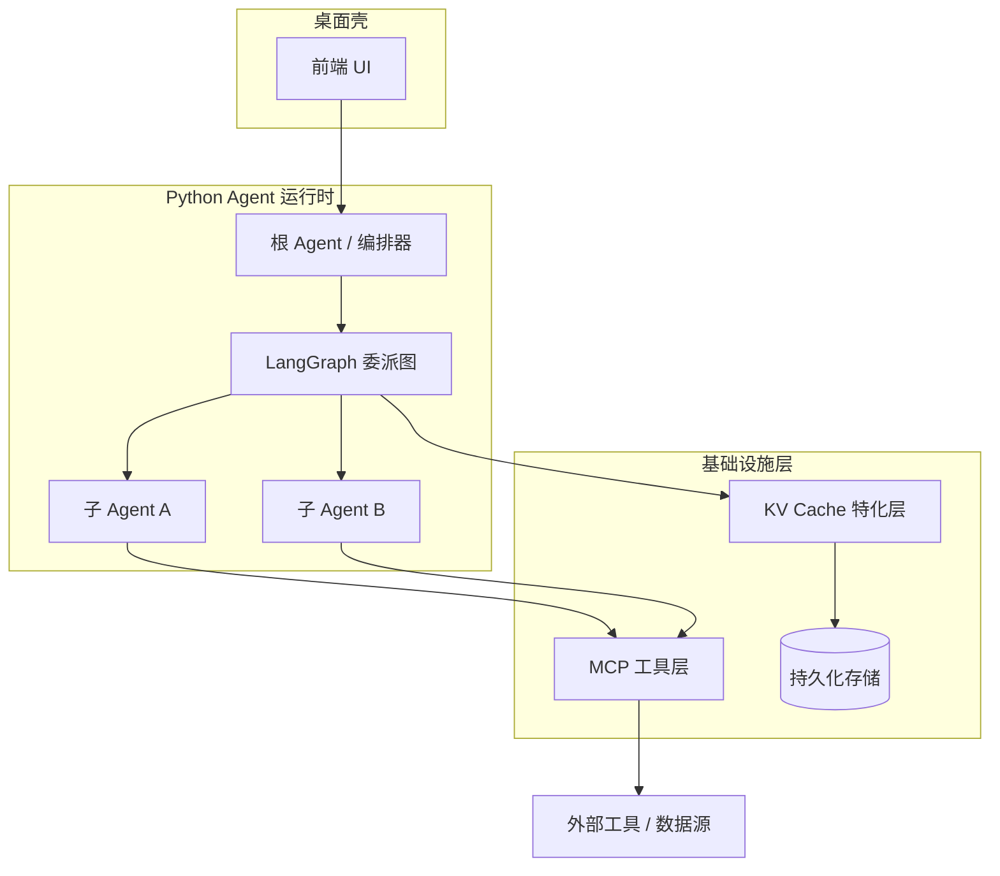

# 总体架构

> 本章为**参考设计**：描述目标形态与职责边界，供后续实现阶段对齐。落地过程中如有调整，将回写到本页。

## 分层视图

## 各层职责

### 桌面壳

- 承载前端 UI，负责跨平台分发（macOS / Windows / Linux）；
- 与本地 Python 运行时通过进程间通信（IPC / 本地端口）交互；
- 框架选型（Tauri / Electron）在后续阶段敲定。

### Python Agent 运行时

- **根 Agent（编排器）**：接收用户的项目与目标，负责顶层规划与任务拆解；
- **LangGraph 委派图**：把任务组织成树形结构，管理状态流转、检查点与恢复；
- **子 Agent**：承接具体子任务，可继续向下委派。

### 基础设施层

- **KV Cache 特化层**：缓存上下文与结果，并对外暴露接口供用户特化能力；
- **MCP 工具层**：统一接入外部工具与数据源；
- **持久化存储**：任务状态、检查点与缓存落盘。

## 关键设计原则

1. **编排与能力分离**：委派结构由 LangGraph 负责，具体“能做什么”由 MCP 与 KV Cache 特化层注入。
2. **特化不侵入核心**：用户自定义能力通过 KV Cache 层接口接入，核心编排逻辑保持稳定。
3. **可观测与可恢复**：委派树上的每个节点都可追踪、可局部重试。

## 深入阅读

- [任务委派树](delegation-tree.md)
- [推理强度](reasoning-effort.md)
- [KV Cache 特化层](kv-cache-layer.md)
- [MCP 集成](mcp.md)
