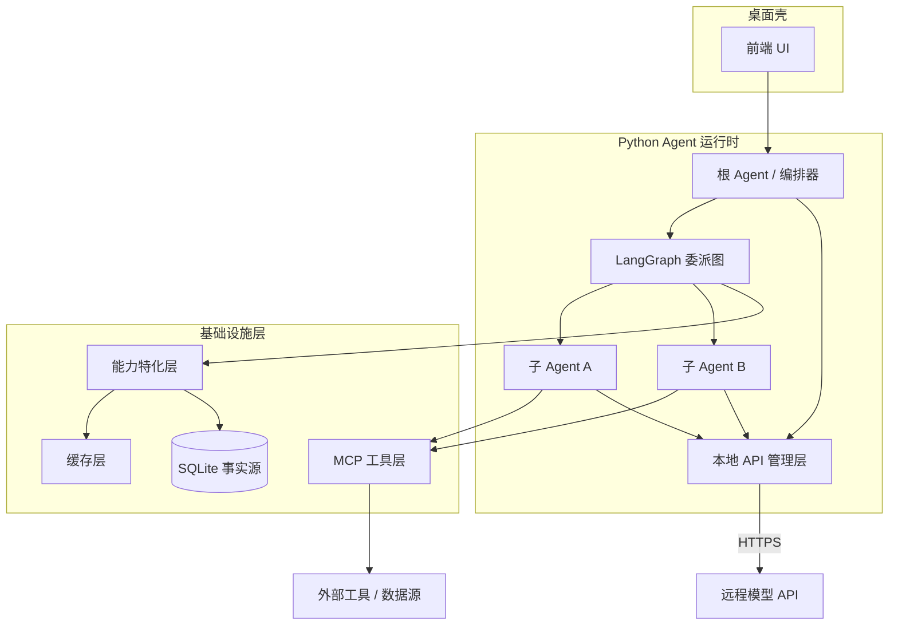

# 总体架构

> 本章为**参考设计**：描述目标形态与职责边界，供后续实现阶段对齐。落地过程中如有调整，将回写到本页。

## 分层视图

## 各层职责

### 桌面壳

- 承载前端 UI，负责跨平台分发（macOS / Windows / Linux）；
- Nuxt/Pinia 只维护 UI 状态和后端数据缓存，不保存会话事实；
- Tauri Rust broker 通过 stdio NDJSON 监督并中继 Python sidecar，通过系统钥匙串和文件选择器提供最小系统能力；
- 框架选型已定：Tauri 2 + Nuxt（Vue3+TS，SPA），见 [ADR-007](decisions.md#adr-007)。

### Python Agent 运行时

- **本地 API 管理层**：统一管理模型密钥与端点，构建模型客户端（[模型接入](model-access.md)）；
- **根 Agent（编排器）**：接收用户的项目与目标，负责顶层规划与任务拆解；
- **LangGraph 委派图**：把任务组织成树形结构，管理状态流转、检查点与恢复；
- **子 Agent**：承接具体子任务，可继续向下委派。
- **应用服务与 Run Manager**：按会话管理运行锁、取消令牌、重试和确认；同一会话互斥，不同会话可并行。

### 基础设施层

- **能力特化层**：对外暴露接口，注入上下文 / 工具 / 提示 / 检索策略（[能力特化层](capability-layer.md)）；
- **缓存层**：prompt / 结果复用，降低 token 成本与延迟（内部优化）；
- **MCP 工具层**：统一接入外部工具与数据源；
- **SQLite 持久化**：会话、消息、运行、任务、附件、确认和非敏感设置的唯一事实源，启用 WAL 与版本化迁移。

## 关键设计原则

1. **编排与能力分离**：委派结构由 LangGraph 负责，具体“能做什么、知道什么”由能力特化层与 MCP 注入。
2. **特化不侵入核心**：用户自定义能力通过能力特化层接口接入，核心编排逻辑保持稳定。
3. **密钥与模型解耦**：模型客户端由本地 API 管理层统一构建，密钥不进入编排状态。
4. **可观测与可恢复**：委派树上的每个节点都可追踪、可局部重试。
5. **协议与传输分离**：stdio 与 WebSocket 共用 protocol v1 dispatcher，所有实体依靠 `session_id/run_id/task_id` 归并。
6. **敏感数据隔离**：API Key 只进入系统钥匙串与运行时安全注入，不进入 SQLite、前端 Store、事件或日志。

## 深入阅读

- [桌面应用架构](desktop.md)
- [运行时协议 v1](runtime-protocol.md)
- [任务委派树](delegation-tree.md)
- [推理强度](reasoning-effort.md)
- [能力特化层](capability-layer.md)
- [模型接入与 API 管理](model-access.md)
- [MCP 集成](mcp.md)
- [关键决策 (ADR)](decisions.md)
