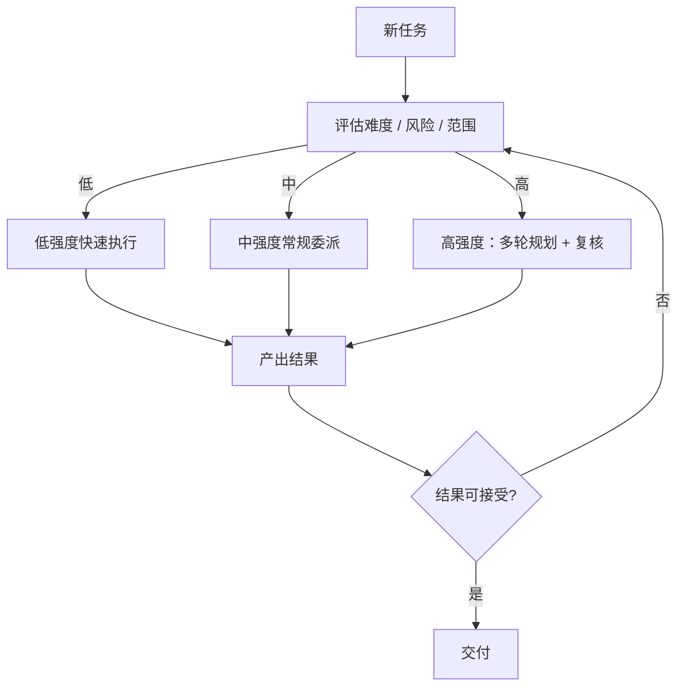

# 推理强度

> 本章为**参考设计**。目标：**由 Agent 自身决定委派质量**（推理强度），而非让用户手工逐档选择。

## 概念

“推理强度”指一次委派任务投入的推理资源档位，类比 CodeX 的 reasoning effort。档位越高，规划与推理越充分，但成本与延迟也越高。

| 档位 | 适用任务 | 代价 |
| --- | --- | --- |
| 低 | 机械重复、模式明确的改动 | 快、省 |
| 中 | 常规编码与局部重构 | 平衡 |
| 高 | 架构决策、高风险跨模块改动 | 慢、贵 |

## 谁来决策

决策权在 **Agent 的规划阶段**，而不是用户：

评估依据可包括（实现阶段细化）：

- 任务涉及的文件范围与代码依赖；
- 是否触碰公共接口 / 数据模型 / 安全边界；
- 历史相似任务的成功率；
- 用户或父 Agent 给定的约束与预算。

## 与委派树的关系

推理强度是**委派节点的一个属性**：根 Agent 拆解任务时，为每个子任务标注建议档位；子 Agent 可在自己的子树内再次评估调整。这样：

- 简单子树不浪费资源；
- 关键子树自动升级到高强度并增加复核环节；
- 强度决策随树逐级细化。

## 边界情况

- 预算超限时的降级策略；
- 用户显式指定档位与 Agent 自决的优先级；
- 强度升级后的复核（review）与回滚机制。

相关：[任务委派树](delegation-tree.md)。
