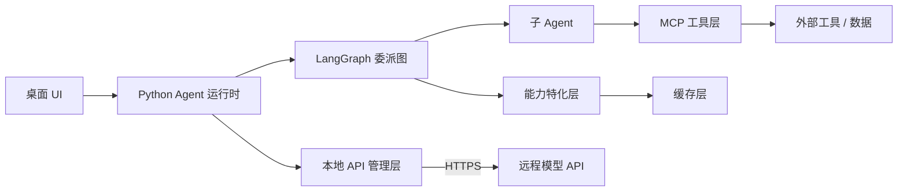

# 技术栈

## 已确定

| 组件 | 角色 | 说明 |
| --- | --- | --- |
| [LangChain Core](https://www.langchain.com/) | Agent 核心抽象 | 模型调用、工具绑定、消息与 Prompt 抽象（`langchain-core`） |
| [LangGraph](https://www.langchain.com/langgraph) | 有状态任务委派图 | 承载委派树、状态流转、子图与检查点 |
| [MCP](https://modelcontextprotocol.io/) | 工具 / 数据接入 | 通过 MCP Server 接入外部工具与上下文 |
| 能力特化层 | 能力可插拔 | 注入上下文 / 工具 / 提示 / 检索策略，与缓存解耦 |
| 本地 API 管理层 | 模型接入 | 远程 API + 密钥/端点本地管理（`langchain-openai` 等集成包） |
| uv | Python 环境管理 | 统一管理 Python 版本与依赖 |

> 依赖策略见 [ADR-003](../architecture/decisions.md#adr-003)：**不引入 `langchain` 元包**，直接组合 `langchain-core` + `langgraph` + 各集成包。

## 桌面壳（已确定，见 ADR-007）

| 组件 | 角色 | 说明 |
| --- | --- | --- |
| [Tauri 2](https://tauri.app/) | 跨平台打包与分发 | Rust 核心 + 系统 webview，sidecar 监督、钥匙串、更新器（[ADR-007](../architecture/decisions.md#adr-007)） |
| [Nuxt](https://nuxt.com/) | 桌面 UI | Vue 3 + TypeScript，SPA 模式（`ssr: false`），产物交 Tauri 打包 |

> Python Agent 运行时以 **sidecar** 形式随应用分发，经 **stdio（NDJSON 中继，由 Rust 转发）** 与前端通信，不监听本地端口；sidecar 用 **python-build-standalone + uv** 打包。详见[桌面应用架构](../architecture/desktop.md)。

## 各组件如何协作

- **LangChain Core** 提供 Agent 编排所需的基础抽象；
- **LangGraph** 负责把委派关系组织成有状态的图，并持久化检查点；
- **MCP** 是工具与外部世界的统一接入协议；
- **能力特化层** 是用户注入自定义能力的落点，缓存层独立做性能优化；
- **本地 API 管理层** 统一构建模型客户端，密钥不进入编排状态。

更详细的职责划分见[总体架构](../architecture/overview.md)。
