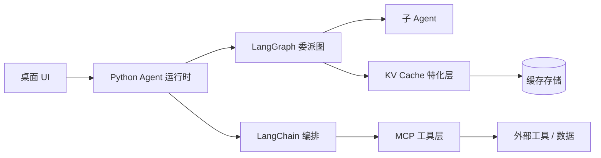

# 技术栈

## 已确定

| 组件 | 角色 | 说明 |
| --- | --- | --- |
| [LangChain](https://www.langchain.com/) | Agent 与工具编排基础 | 提供模型调用、工具绑定、Prompt 模板等抽象 |
| [LangGraph](https://www.langchain.com/langgraph) | 有状态任务委派图 | 承载委派树、状态流转、子图与检查点 |
| [MCP](https://modelcontextprotocol.io/) | 工具 / 数据接入 | 通过 MCP Server 接入外部工具与上下文 |
| KV Cache | 缓存与能力特化层 | 对外暴露接口，用户自定义特化 Agent 能力 |
| uv | Python 环境管理 | 统一管理 Python 版本与依赖 |

## 待定（后续阶段敲定）

| 组件 | 角色 | 候选 |
| --- | --- | --- |
| 桌面壳 | 跨平台打包与分发 | Tauri / Electron |
| 前端框架 | 桌面 UI | 随桌面壳选型确定 |

## 各组件如何协作

- **LangChain** 提供 Agent 编排所需的基础抽象；
- **LangGraph** 负责把委派关系组织成有状态的图，并持久化检查点；
- **MCP** 是工具与外部世界的统一接入协议；
- **KV Cache** 是缓存与特化的落点，用户在此注入自定义策略。

更详细的职责划分见[总体架构](../architecture/overview.md)。
